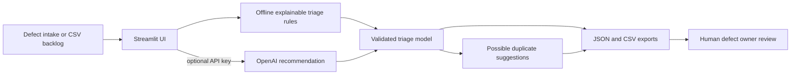

# Architecture

## Component flow

## Decisions

- **Decision support only:** severity, priority, owner team, confidence, and next action are recommendations. A human owner approves the ticket decision.
- **Explainable offline baseline:** keyword rules make a usable demo without a key and provide visible evidence signals.
- **Severity and priority stay distinct:** severity reflects impact; priority reflects response urgency and context such as production scope or a workaround.
- **Duplicate matches are suggestions:** the included Jaccard token-overlap matcher points to similar sample incidents and never closes or merges tickets.
- **LLM integration is optional:** the API path validates enum/range fields and leaves offline behavior available.

## Production considerations

Replace sample incidents with an authorized, access-controlled ticket index. Add tenant-aware permissions, audit history, redaction and retention policies, model evaluation, calibration by product area, human override tracking, and integration safeguards before connecting to a ticket system. Do not send sensitive defect data to an external model unless organizational policy permits it.

